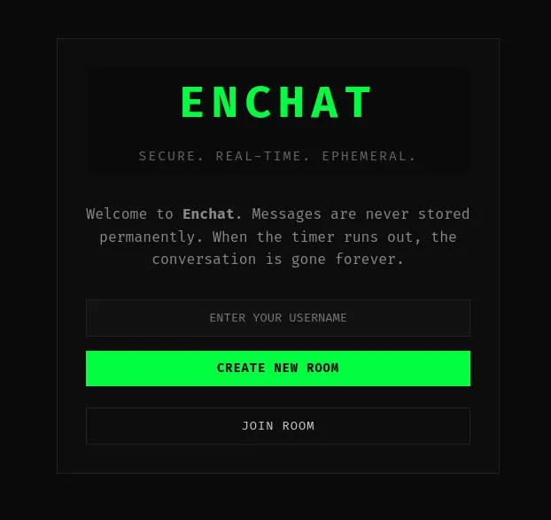

<div align="center">
  <div style="display: flex; align-items: center; justify-content: center; gap: 12px;">
    
    <h1 style="margin: 0; line-height: 1; display: flex; align-items: center; border-bottom: none">Enchat</h1>
  </div>
  <p>A minimalist, high-security, ephemeral chat application.</p>
  <p>
    <code>Zero persistence</code> <code>End-to-end encrypted</code> <code>No login</code>
    <code>Self-destructing rooms</code>
  </p>
  
</div>

---

## What is Enchat?

Enchat is a chat application built around one idea: **privacy enforced by time.** Every conversation lives in a room that self-destructs 30 minutes after it's created — along with the room itself, its message history, and the encryption keys used to protect it.

The server is a dumb relay. It stores room state **in memory only**, never touches a database, and never sees a single plaintext character — messages travel to and from clients already encrypted. If the server is compromised, an attacker only finds ciphertext and keys that don't exist anymore.

There are no accounts, profiles or message history. Just a room id, a username, and a conversation thats ephemeral.

## Key features

- **Self-destructing rooms** — every room is created with a hard 30-minute expiry. When the timer hits zero, the room and all its data are purged from the server and the clients are notified. Rooms can also be terminated early by the room admin.
- **End-to-end encryption** — messages are encrypted with **AES-GCM-256** using a key derived per-conversation via **ECDH (P-256)** key exchange. Private keys are non-extractable and stored per-room in the browser's **IndexedDB**.
- **Zero persistence** — no database. Room state lives in an in-memory `Map` on the server and is wiped on expiry, termination, or restart.
- **No login required** — rooms are created and joined with a single 8-character room ID. Identity is a random UUID scoped to the browser session.
- **Real-time delivery** — WebSockets via Socket.IO push messages instantly to everyone in the room, plus a visible room countdown timer and connection-status indicator.
- **Simple, fast UX** — copyable room id, shared room history for late joiners, system messages on join/leave, and a clean dark UI.

## How encryption works

1. Each user generates an **ECDH P-256 keypair** in their browser (non-extractable) when they enter a room.
2. Public keys are exchanged through the server and broadcast to the room.
3. When two participants are present, each client derives a shared **AES-GCM-256** key from their private key + the peer's public key.
4. Messages are encrypted **before** leaving the browser. The server receives only ciphertext + IV and relays it — it can never decrypt.
5. When the room expires or is terminated, the keypair is purged from IndexedDB. The conversation is now mathematically unrecoverable.

```
   Alice                          Server                      Bob
   --------                        --------                   --------
   gen ECDH keypair                     │                          gen ECDH keypair
   publish pubkey ─────────────────────►│◄───────────────────────── publish pubkey
   derive AES key from Bob's pubkey     │     derive AES key from Alice's pubkey
   encrypt(msg) ──── ciphertext ───────►│─────── ciphertext ───────► decrypt(msg)
                                        │
   room expires ───────────────────────►│ (in-memory store purged, clients notified)
```

## Tech stack

| Layer    | Technology                                                        |
| -------- | ----------------------------------------------------------------- |
| Runtime  | [Bun](https://bun.sh) + TypeScript                                |
| Server   | Express 5 + Socket.IO (WebSockets)                                |
| Client   | Vanilla HTML/CSS/JS |
| Crypto   | Web Crypto API — ECDH P-256, AES-GCM-256, IndexedDB key storage   |

## Getting started

You can use any one of the following methods to run and test Enchat:

**Option 1**:

**Visit the site:** [Enchat](enchat.k4rkie.me)

**Option 2**:

**Using Docker**:
```
git clone git@github.com:k4rkie/enchat.git
cd enchat
docker compose up -d
```

**Option 3**:

**Build it yourself:**

Requires [Bun](https://bun.sh).
```bash
git clone git@github.com:k4rkie/enchat.git
cd enchat
bun install
bun dev
```

If using Option 2 or 3, open `http://localhost:8080`, pick a username, create a room, and share the room ID — or open a second tab/browser to test end-to-end encryption locally.

## Project structure

```
├── src/
│   ├── index.ts              # Express app, static serving, routes
│   ├── chat.ts               # Socket.IO event wiring
│   ├── handlers/
│   │   └── chat.handlers.ts  # Room lifecycle, messaging, room store
│   └── utils/utils.ts
├── client/
│   ├── index.html/js         # Landing: create/join room
│   ├── chat.html/js          # Chat room UI, E2E encryption logic
│   └── utils/crypto/         # Web Crypto API wrapper (keys, derive, encrypt)
└── public/
```

## Roadmap

- [ ] Custom room lifetimes (e.g. 5 min / 1 hour / burn-on-read)
- [ ] Multi-party E2EE for group rooms
- [ ] Message read receipts and typing indicators (metadata-only, unencrypted)

